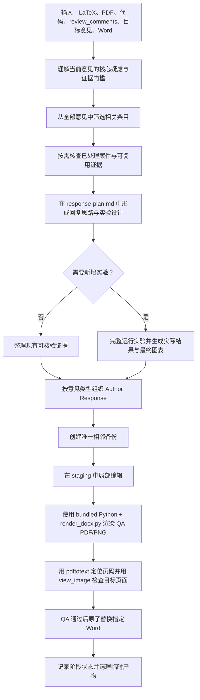

<div align="center">

# IEEE Transactions Review Response Engineer

### 从单条审稿意见出发，构建可复现、可核验、可直接提交的完整证据链

[](./SKILL.md)
[](https://www.ieee.org/)
[](./references/experiment-and-evidence-protocol.md)
[](./SKILL.md)

**一次处理一条意见 · 联合核对论文与代码 · 完整执行必要实验 · 原位更新 response Word**

</div>

---

## 项目简介

`IEEE Transactions Review Response Engineer` 是一个面向学术论文返修场景的 Codex Skill。它不仅撰写回复文字，还会结合论文 LaTeX、最终 PDF、实现代码、完整审稿意见、既往处理记录和实际实验结果，判断审稿人的核心疑虑，设计足够且不冗余的验证，并将证据直接写入用户指定的 response Word。

它适用于：

- IEEE Transactions 论文返修与 rebuttal；
- 需要补充训练、消融、敏感性或统计分析的审稿意见；
- 论文描述与代码实现的一致性核查；
- 基于 Word 模板撰写 `Author Response`；
- 需要 IEEE 风格图表和可复现实验记录的回复任务。

## 核心能力

- **单条意见聚焦**：每次只处理一条意见，围绕审稿人的真实疑虑建立证据链。
- **论文—代码联合理解**：核对研究动机、方法设计、实验设置、结论边界及对应实现。
- **关联意见筛选**：先阅读完整 `review_comments`，再按需检查相关的已处理案件和可复用证据。
- **实验完整执行**：不擅自缩减已确定的正式方案，按预定验证集早停执行；默认单种子。
- **结果可追溯**：经验性结果绑定本案件或已核验外部结果、字段位置、代码和运行配置；论文事实另按来源核验。
- **按意见类型写作**：明确要求新增内容的意见先说明已完成的增补，再报告证据和校准解释；要求判断现有主张的意见才在证据充分时结论优先。
- **IEEE 图表规范**：使用 Times New Roman，保证最终栏宽下可读，并规范标注多子图编号。
- **Word 原位交付**：备份后只修改目标 `Author Response`，保留模板其余内容和格式。

## 工作流



## 输入

处理一条意见时，建议提供：

| 输入 | 用途 |
|---|---|
| 论文 LaTeX 源文件 | 定位方法、公式、实验设置和待修改表述 |
| 论文最终 PDF | 核对最终排版、图表、编号和实际呈现内容 |
| 实现代码 | 理解数据、模型、训练、评估和配置逻辑 |
| 完整 `review_comments` | 在所有审稿意见中筛选与当前意见相关的条目 |
| 当前意见及稳定编号 | 例如 `R2-C4`，用于案件和 Word 精确定位 |
| 既往案件目录 | 仅在相关意见已经处理时复用可核验证据 |
| response Word | 作为最终 Author Response 的原位交付文件 |

## 核心产物

```text
R2-C4/
├── response-plan.md
└── experiment/                 # 新增实验/分析或必要复用图表需要时创建
    ├── run_*.py
    ├── config.*                # 原框架或复现确实需要时保留
    ├── results.json/csv        # 机器可读的实际结果
    ├── table.*                 # 最终回复使用的表格
    └── figure.pdf/png          # 最终回复使用的图

response_to_reviewers.docx
response_to_reviewers.before-R2-C4.docx
```

`response-plan.md` 集中记录：

1. 原始意见；
2. 核心疑虑、真实意图与证据门槛；
3. 相关论文位置、代码文件、配置和现有结果；
4. 关联意见、处理状态与逐项复用判定；
5. 回复思路和完整实验设计；
6. 实际结果、来源字段和结论边界；
7. Word 目标块、备份路径和验证结论。

## 关联意见与证据复用

Skill 使用由宽到窄的检索方式控制工作量：

1. 完整读取一次 `review_comments`；
2. 根据疑虑、主张、方法模块、数据集、指标和证据需求筛选相关意见；
3. 未处理的相关意见只记录关联和潜在共用点；
4. 已处理的相关意见先只读取对应 `response-plan.md`；
5. 只有准备复用某项证据时，才读取方案明确引用的结果、配置和代码文件；
6. 复用前逐项核对数据划分、代码 revision、训练预算、checkpoint、基线、指标、种子和统计单位。

任何关键条件不一致时，既有结果只作为背景；当前意见要求的新控制变量、数据、基线、指标和分析仍需完整执行。

## 实验与证据标准

- 以原论文或官方实现确定与当前问题相适应的完整方案，不擅自缩减正式预算；
- 为各方法提供一致的数据、预处理、评价实现和公平调参范围；
- 预先写明实验变量、随机种子、指标和结论判定规则；
- 保留全部计划运行，不挑选有利结果；
- 涉及统计推断时报告适用的样本量、效应量、置信区间和检验，确定性分析不机械套用；
- 负面或混合结果必须如实呈现，并相应收缩论文主张；
- 只生成最终证据链真正使用的表格和图片。

详细规则见 [精简实验与证据协议](./references/experiment-and-evidence-protocol.md)。

## Author Response 与 Word 交付

默认使用随 Skill 保存的 [三段空白 Word 模板](./assets/response-template.docx)：红色 `Original Comment`、蓝色 `Author Response`、绿色 `Changes in Manuscript`。模板保留原文档的封面、编号层级、字体、区域样式和页码；论文特定内容与图片已移除。

工作顺序为“先回复，后统一修改正文，再同步修改记录”。先完成必要实验与回复，正文编辑可按最终提交口吻写 `We have added/revised ...`；待落实内容只记录在 `response-plan.md`，新建文档的绿色区域暂时留空。正文落实后，再填写真实修改摘录与位置，并校正回复中的定位。实验结果与证明不得预写为已完成。回复写入完成、正文落实、修改记录同步分别记录，全部一致后才可提交。

已有 response Word 直接编辑；新建时复制模板到用户指定位置，随后运行案件初始化脚本。扩展意见块和阶段切换详见 [模板与正文同步规则](./references/template-and-revision-workflow.md)。

内部方案可以充分分析疑虑、真实意图和证据门槛，但最终回复不复述处理过程。`Author Response` 按意见类型组织：明确要求新增实验、分析、证明或内容的意见采用“审稿人建议/要求 → 已完成的增补 → 必要设置 → 实际结果 → 校准解释 → 论文修改”；要求判断现有主张的意见才在证据充分时使用“结论 → 证据 → 修改”的顺序。首句必须直接进入当前意见的事实；明确增补型意见可写 `Following the reviewer’s suggestion, we added ...`，但不得在实验或分析结果之前写 `prove`、`confirm` 或“决定性证据”等未经支撑的强结论。公式和数学符号统一使用 TeX：行内使用 `$...$`，独立公式单独成行使用 `\[...\]`；可直接输入的符号如 `℃` 直接使用；不得用 `L2`、`degrees C` 等原生文本代替 `$L_2$`、`℃`，也不得使用 Office Math 或 Word 原生公式。表格和图片只保留当前论证需要的信息。

写入 Word 前检查：删除开场句是否不损失事实；若不损失，直接删除。限制条件只在会改变结论范围时保留，并放在证据之后。

Word 更新遵循以下规则：

- 最终内容直接写入用户指定的 response Word；
- 首次修改前创建唯一相邻备份：`<word-stem>.before-<comment-id>.docx`；后续阶段核验归属后续用，不覆盖；
- 回复阶段只修改当前意见的 `Author Response`；正文同步阶段填写 `Changes in Manuscript` 并同步必要回复句；
- 保留 `Original Comment`、非目标区域、其他意见和模板格式；
- 写回后重新读取目标回复块，核对正文、表格、图片、数字、符号和定位锚点；
- macOS 上先调用 `load_workspace_dependencies`，使用其返回的 bundled Python 和文档处理依赖；
- 设置稳定且可写的 `TMPDIR`（优先 `/private/tmp`），用 bundled `render_docx.py` 加 `--emit_pdf` 将 staging Word 渲染为临时 PDF 和 `page-<N>.png`；
- 用 `python-docx` 定位目标 `Original Comment`/`Author Response`，再用 `pdftotext`/`pdfinfo` 确定实际页码，最后用 `view_image` 在 100% 检查目标页面；不把具体页码或意见编号写死；
- 只检查目标回复实际占用的页面，跨页时检查全部覆盖页面；分页边界或布局异常时再扩大到相邻页；
- 核对本次新增或修改的回复正文为 Times New Roman 11 pt，并保留封面及结构标题样式，图题/表题为 Times New Roman 10 pt 居中加粗，图题位于图下方、表题位于表上方，表内文字为 Times New Roman 10 pt，表格为三线表；
- staging、渲染页、临时 PDF 和运行日志在成功后清理；渲染失败时停止 QA，修正后重新渲染。

详细规则见 [回复、图表与 Word 原位更新协议](./references/response-and-artifact-protocol.md)。

## 安装

### Windows PowerShell

```powershell
git clone https://github.com/whiteMo0623/ieee-transactions-review-response-engineer.git `
  "$env:USERPROFILE\.codex\skills\ieee-transactions-review-response-engineer"
```

### macOS / Linux

```bash
git clone https://github.com/whiteMo0623/ieee-transactions-review-response-engineer.git \
  "${CODEX_HOME:-$HOME/.codex}/skills/ieee-transactions-review-response-engineer"
```

调用名称：

```text
$ieee-transactions-review-response-engineer
```

## 使用示例

```text
$ieee-transactions-review-response-engineer

请处理 Reviewer 2 的 Comment 4。论文 LaTeX、最终 PDF、实现代码、完整
review_comments、既往案件目录和 response_to_reviewers.docx 已放在项目中。
请完整执行必要实验，并将 Author Response 直接写入指定 Word；案件目录只保留
response-plan.md，以及必要的实验代码、实际结果和最终图表。
```

## 初始化案件

```bash
python "$SKILL_DIR/scripts/init_review_case.py" R2-C4 \
  --root response_exp \
  --paper-tex path/to/main.tex \
  --paper-pdf path/to/paper.pdf \
  --code-root path/to/repository \
  --review-comments path/to/review_comments.docx \
  --comment-file path/to/comment.md \
  --word-file path/to/response_to_reviewers.docx
```

将 `SKILL_DIR` 设为本 Skill 的绝对目录，并从任务工作目录运行（Python 3.9+；macOS 优先 bundled Python）。脚本仅创建当前意见的 `response-plan.md` 并记录输入路径和可用 Git revision；Git 不可用或无提交时记为 null。`--comment-file` 须为 UTF-8 文本，也可使用 `--comment-text`。首次无既往案件时省略 `--previous-cases`。

已有案件用 `python "$SKILL_DIR/scripts/init_review_case.py" R2-C4 --root response_exp --resume` 定位原方案，不重新初始化或覆盖文件。

## 验收

完成当前阶段并清理本次临时产物后集中运行；失败修复后可重跑：

```bash
python "$SKILL_DIR/scripts/audit_review_case.py" path/to/R2-C4
```

审计内容包括：

- `response-plan.md` 必需章节存在且非空，作者章节无未处理的 TODO/TBD；
- `experiment_required` 已明确为 `true` 或 `false`；
- 从 `code_files`、`result_files` 显式引用核查代码与结果文件，允许原项目及既往案件路径；
- 核查已知默认冗余产物，按 `approved_artifacts` 接受用户明确要求的例外；
- 指定 Word 和相邻备份具有基本 DOCX 包结构，且文件字节发生变化。

上述检查不证明目标块已正确更新、结果真实、版式通过或可提交；仍须目标块回读、视觉 QA 和阶段状态核验。元数据字段格式见实验协议，旧案件在原方案补填即可。

两个辅助脚本仅使用 Python 标准库。维护脚本后可运行隔离回归测试；样例仅在系统临时目录生成，测试结束自动清理：

```bash
PYTHONDONTWRITEBYTECODE=1 python -m unittest discover -s "$SKILL_DIR/tests" -v
```

## 仓库结构

```text
.
├── README.md
├── SKILL.md
├── agents/
│   └── openai.yaml
├── assets/
│   └── response-template.docx
├── references/
│   ├── experiment-and-evidence-protocol.md
│   ├── response-and-artifact-protocol.md
│   └── template-and-revision-workflow.md
├── scripts/
│   ├── init_review_case.py
│   └── audit_review_case.py
└── tests/
    └── test_review_case.py
```

---

<div align="center">

**让每一条 Author Response 都由真实、完整、可复现的证据支撑。**

</div>
